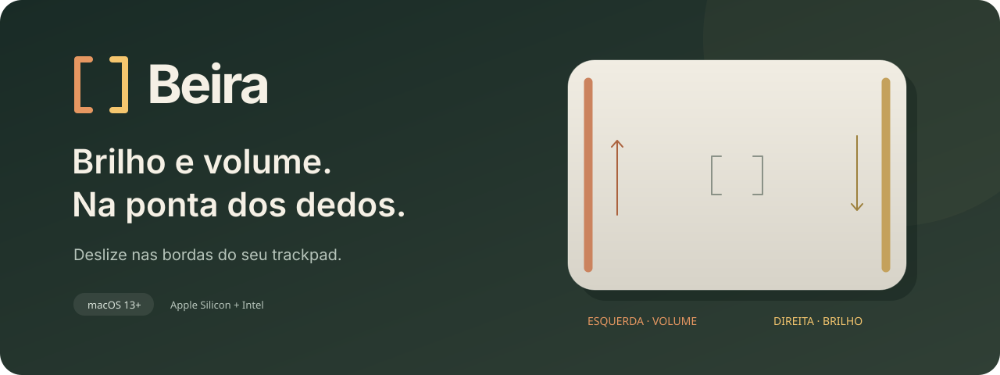

<div align="center">



**Um app nativo para controlar o Mac pelas bordas do trackpad.**

[Baixar para Apple Silicon](https://github.com/Benfic4rthur/Beira/releases/latest/download/Beira-AppleSilicon.zip) · [Baixar para Intel](https://github.com/Benfic4rthur/Beira/releases/latest/download/Beira-Intel.zip) · [Todas as versões](https://github.com/Benfic4rthur/Beira/releases) · [Reportar um problema](https://github.com/Benfic4rthur/Beira/issues)

macOS 13 ou superior · Swift + AppKit + SwiftUI · Versão 0.1.2

</div>

## O que é o Beira?

O Beira transforma duas faixas estreitas do trackpad em controles de volume e brilho. Ele fica na barra de menus, pronto para usar, sem precisar abrir uma janela a cada ajuste.

| Onde deslizar | O que acontece |
| --- | --- |
| Borda esquerda | Ajusta o volume |
| Borda direita | Ajusta o brilho |
| Para cima | Aumenta |
| Para baixo | Diminui |
| Uma passada completa, de ponta a ponta | Busca o mínimo ou o máximo |
| Movimento iniciado na horizontal ou no centro | Continua disponível para o ponteiro |

O gesto precisa começar na borda e ter intenção vertical. Encostar sozinho não altera o nível. Dois dedos cancelam o ajuste. Os lados podem ser invertidos nos ajustes do app.

## Download

| Seu Mac | Arquivo |
| --- | --- |
| **Apple Silicon** — MacBook Air, MacBook Pro e outros Macs com chip da família M | [**Beira para Apple Silicon · ZIP**](https://github.com/Benfic4rthur/Beira/releases/latest/download/Beira-AppleSilicon.zip) |
| **Intel** — MacBooks e outros Macs com processador Intel | [**Beira para Intel · ZIP**](https://github.com/Benfic4rthur/Beira/releases/latest/download/Beira-Intel.zip) |

Para conferir seu processador: menu Apple → **Sobre Este Mac**. Se aparecer um chip da família M, escolha Apple Silicon; se aparecer Intel, escolha Intel.

**Requisitos:** macOS 13 Ventura ou superior e trackpad compatível. O uso principal é no trackpad integrado do MacBook. O retorno tátil precisa de um trackpad com Force Touch. Em um Mac de mesa, é necessário um trackpad externo compatível; esse cenário ainda não foi validado nesta versão.

### Instalar e liberar no macOS

Os downloads **não têm certificado de distribuição nem notarização da Apple**. Por isso, o macOS pode impedir a primeira abertura. As versões usam apenas a assinatura técnica ad hoc, feita localmente, sem conta paga de desenvolvedor.

1. Baixe o ZIP da arquitetura correta e extraia o arquivo.
2. Arraste **Beira.app** para a pasta **Aplicativos**.
3. Abra o **Terminal** e execute o comando abaixo, depois de instalar o Beira nesse caminho:

```sh
xattr -dr com.apple.quarantine "/Applications/Beira.app"
```

Esse comando remove a marca de quarentena **somente do Beira**. Ele não desativa a proteção do macOS para os demais aplicativos. Use-o apenas para a cópia baixada deste repositório.

4. Abra o **Beira** pela pasta Aplicativos, pelo launcher ou pelo Spotlight.
5. Clique em **Permitir acesso** e habilite o Beira em **Ajustes do Sistema → Privacidade e Segurança → Acessibilidade**. Em versões mais novas do macOS, essa seção pode aparecer como **Controle do Dispositivo e Acesso a Dados**.
6. Volte ao app e confira o status **Pronto para deslizar**.

O comando do Terminal libera a abertura do arquivo; a autorização nos Ajustes permite controlar brilho e volume. São etapas diferentes. Não é necessário compilar o projeto para usar os downloads.

## Do seu jeito

- **Largura das bordas:** escolha uma faixa de 1% a 8% de cada lado.
- **Sensibilidade e ajustes finos:** controle a resposta nos movimentos menores.
- **Retorno tátil:** sinta um pulso discreto nos ajustes, quando o hardware permitir.
- **Cursor no lugar:** mantenha o ponteiro ancorado durante o gesto reconhecido.
- **Proteção ao digitar:** evite ajustes por toques acidentais depois de uma tecla.
- **Tecla Option opcional:** exija ⌥ para ativar os gestos.
- **Parte inferior:** limite o início do gesto à região inferior do trackpad.
- **Inverter os lados, pausar e abrir ao iniciar o Mac:** tudo pela janela de ajustes ou pela barra de menus.

Fechar a janela mantém o Beira em execução. Clique no ícone **[ ]** na barra de menus para abrir os ajustes, pausar ou encerrar o app.

O Beira é gratuito para baixar e usar. Não há compra, assinatura ou conta para criar. Os downloads ficam nas [Releases do GitHub](https://github.com/Benfic4rthur/Beira/releases).

## Privacidade

O app funciona localmente. Não há conta, telemetria, chamadas de rede nem armazenamento dos toques. A proteção ao digitar observa eventos de teclado para interromper o gesto; o conteúdo digitado não é registrado.

## O que esta versão cobre

A versão 0.1.2 mostra todos os ajustes em uma janela dimensionada pelo conteúdo, sem barra de rolagem. O aplicativo segue em sua fase inicial de testes. O funcionamento inicial de brilho e volume foi confirmado pelo autor em um **MacBook Pro com Apple Silicon**. A calibração completa e os bloqueios de gesto também têm testes automatizados. A versão **Intel foi compilada separadamente**, mas ainda não foi testada em hardware Intel.

O Beira envia eventos equivalentes às teclas de sistema. A resposta depende da tela e da saída de áudio que o macOS está usando. Dispositivos com volume fixo podem não responder; controle DDC de monitores externos não está incluído. A sensação háptica e o comportamento após suspensão devem ser verificados no dispositivo real.

A leitura dos contatos usa a API privada `MultitouchSupport`, isolada em um adaptador. Atualizações do macOS podem exigir ajustes de compatibilidade.

## Se algo não funcionar

**A permissão está ativada, mas o app ainda pede acesso?** Encerre o Beira. Remova apenas a entrada dele da lista de permissões, adicione novamente `/Applications/Beira.app` e abra o app. Uma atualização local sem certificado de distribuição pode exigir renovar essa autorização.

**O trackpad aparece como indisponível?** Use **Reconectar trackpad** nos ajustes. Ao reportar o problema, informe o modelo do Mac, a versão do macOS e se o trackpad é interno ou externo.

**O gesto não ativa?** Comece dentro da faixa lateral com um dedo, deslize na vertical e confira se o Beira está ativado. Se a opção de exigir Option estiver marcada, mantenha ⌥ pressionada. Após um gesto cancelado, levante o dedo antes de tentar novamente.

**Como atualizar?** Encerre o Beira, baixe a nova versão e substitua o aplicativo em Aplicativos. Repita a liberação do Terminal ou da permissão somente se o macOS solicitar.

## Para desenvolver

Requer Xcode com Swift 6 ou superior, SDK do macOS e ferramentas de linha de comando.

```sh
git clone https://github.com/Benfic4rthur/Beira.git
cd beira
swift test
./scripts/run.sh
```

O aplicativo é gerado em `build/Beira.app`. Abra o pacote `.app` para testar permissões e hardware. Também é possível editar `Package.swift` no Xcode.

| Comando | Função |
| --- | --- |
| `swift test` | Testa o reconhecimento de gestos |
| `./scripts/build.sh` | Compila o app para a arquitetura local |
| `./scripts/run.sh` | Compila e abre a cópia de desenvolvimento |
| `./scripts/install.sh` | Compila, instala em Aplicativos e abre; encerre a versão atual antes |
| `./scripts/release.sh` | Gera os dois downloads e seus checksums, inteiramente no Mac |

As versões são compiladas e publicadas manualmente. **Este projeto não usa GitHub Actions.**

### Arquitetura

```text
TrackpadBridge (C) → contatos copiados → BeiraCore (Swift)
                                           ↓
                                 gesto vertical reconhecido
                                           ↓
                              controles do macOS + retorno tátil
                                           ↓
                                interface SwiftUI / AppKit
```

- **BeiraCore:** máquina de estados independente do hardware, com testes para origem do gesto, direção, dois dedos, extremos e movimentos rápidos.
- **TrackpadBridge:** captura os contatos e isola a API privada. Não conserva ponteiros depois do callback.
- **Beira:** barra de menus, preferências, proteção ao digitar, ciclo de vida e saída dos controles.

Veja o [guia de publicação local](docs/releases.md), o [registro de validação](docs/verification.md) e os [avisos de terceiros](THIRD_PARTY_NOTICES.md). A licença MIT das declarações de ABI está preservada nesses avisos e dentro dos aplicativos distribuídos.

---

Criado por [Arthur Benfica](https://github.com/Benfic4rthur).
